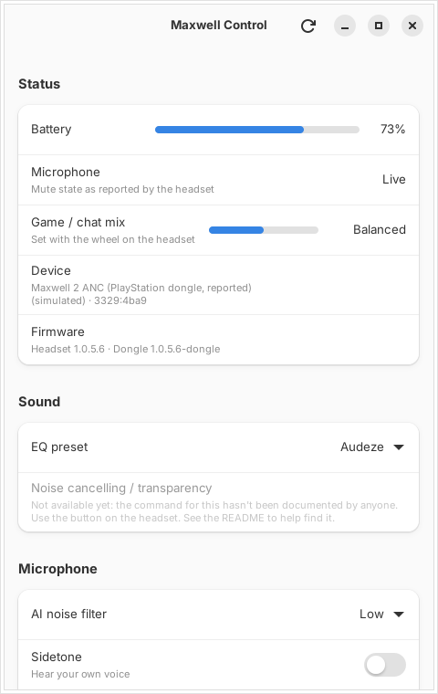

# Maxwell Control

See and change the settings of an **Audeze Maxwell 2 ANC** (and Maxwell 2 / Maxwell) on Arch Linux.
It has a GTK 4 / libadwaita window with a system-tray icon, and a `maxwellctl` command-line tool.



> **Status: untested on real hardware.** Everything here is built from protocol documentation
> published by other projects (see [Where the protocol comes from](#where-the-protocol-comes-from)).
> Nobody has publicly confirmed that the Maxwell 2 ANC answers this protocol yet. The app has only
> been run against its own simulated headset. Please report what works and what doesn't.

## What it can do

The **Confidence** column says how well each feature is backed by the sources. *Confirmed* means
on Maxwell 2 hardware (non-ANC) by at least one source. No row is confirmed on the ANC model.

| Feature | Read | Change | Confidence |
|---|---|---|---|
| Battery % | ✓ | – | Confirmed (HeadsetControl + audezeforlinux) |
| Mic muted / live | ✓ | – | Confirmed |
| EQ preset (Audeze, Treble Boost, Bass Boost, Immersive, Competition, Footsteps, Custom 1–4) | ✓ | ✓ | Confirmed |
| AI mic noise filter (off/low/high) | ✓ | ✓ | Confirmed |
| Sidetone on/off + level | ✓ | ✓ | Confirmed. The on/off command *toggles*, so the app reads the state first and never retries it |
| Voice prompt volume (0 = off … 15) | ✓ | ✓ | Confirmed (range from HeadsetControl) |
| Game/chat mix | ✓ | – (wheel on the headset) | Confirmed |
| Auto power-off | best effort | ✓ | Writing: confirmed. **Reading: unverified** (shows "unknown" if the reply isn't understood) |
| Firmware versions (headset + dongle) | ✓ | – | Confirmed by audezeforlinux only |
| **ANC / transparency mode** | ✗ | ✗ | **Unknown.** No public source documents the command (see below) |

Not included because the sources mark them as unverified or broken on the Maxwell 2: volume
limiter, per-channel gain, custom EQ curve editing, and firmware updates.

### About ANC control

I couldn't find any documentation of how the ANC on/off/transparency setting is read or changed
over USB, in any public project, as of 23 Nov 2026. The HeadsetControl device request for the ANC
model ([#636](https://github.com/Sapd/HeadsetControl/issues/636)) is still open and lists no
commands. The app doesn't guess, because sending unknown write commands to the headset could
change settings unpredictably.

You can help find it using two **read-only** tools:

```sh
# 1. Watch what the headset sends by itself while you press the ANC button
maxwellctl monitor --seconds 30

# 2. Snapshot every readable setting, switch ANC mode with the button, then compare
maxwellctl scan --save anc-on.json
#    (press the ANC button)
maxwellctl scan --compare anc-on.json
```

`scan` only sends the same kind of *read* requests the app uses for known settings, but to ids
nobody has documented. That should be harmless, but no source has verified it. If a value changes
along with the ANC mode, that's very likely the setting, and support for it can be added.

## Install on Arch Linux

```sh
sudo pacman -S --needed base-devel git python-gobject gtk4 libadwaita
git clone https://github.com/porgey365/maxwell-control.git
cd maxwell-control/packaging/arch
makepkg -si
```

This installs:
- `maxwell-control`, the GUI, with an app-menu entry called "Maxwell Control"
- `maxwellctl`, the CLI
- `/usr/lib/udev/rules.d/70-maxwell-control.rules`, which lets your logged-in user open the dongle
  without root

**Replug the dongle after installing** so the udev rule applies.

> The PKGBUILD has not been run on an Arch machine yet. It follows the standard Arch Python
> packaging layout, but if `makepkg` complains, please report it.

### Run from source without installing

```sh
sudo install -Dm644 data/70-maxwell-control.rules /etc/udev/rules.d/70-maxwell-control.rules
sudo udevadm control --reload-rules   # then replug the dongle
python -m maxwell_control.gui         # GUI
python -m maxwell_control.cli status  # CLI
```

### Try it without the headset

```sh
MAXWELL_SIMULATE=1 python -m maxwell_control.gui
```

## Tray icon

The app puts a headset icon in your bar's system tray:
- **Hover:** battery % and mic/EQ status.
- **Left-click:** opens the window.
- **Right-click menu:** battery, EQ preset, mic noise filter, sidetone on/off, Open, Quit.

The icon turns into a battery warning icon at 15% or below. Closing the window keeps the app
running in the tray; use **Quit** from the menu to exit. If no tray is available, closing the
window quits as usual.

The icon uses the StatusNotifierItem protocol. It works with Noctalia's Tray widget, Waybar's
`tray` module and KDE Plasma. GNOME needs the AppIndicator extension. If the icon doesn't show up
in Noctalia, make sure the **Tray** widget is in your bar.

Options:
- `maxwell-control --hidden` starts in the tray only, for autostart.
- `maxwell-control --no-tray` turns the tray icon off.

Start it with your session, depending on the compositor you run Noctalia on:

```text
# niri (~/.config/niri/config.kdl)
spawn-at-startup "maxwell-control" "--hidden"

# Hyprland (~/.config/hypr/hyprland.conf)
exec-once = maxwell-control --hidden
```

## CLI

```text
maxwellctl                        # same as 'status'
maxwellctl status [--json] [--firmware]
maxwellctl battery
maxwellctl eq [1-10 | name]       # e.g. maxwellctl eq "bass boost"
maxwellctl noise-filter [off|low|high]
maxwellctl sidetone [on|off|LEVEL]
maxwellctl voice-prompts [0-15]
maxwellctl auto-off [0|5|10|15|30|45|60|90|120|240|360]
maxwellctl chatmix
maxwellctl firmware
maxwellctl list                   # detected devices and all Audeze hidraw nodes
maxwellctl monitor                # print messages the headset sends on its own
maxwellctl scan [--save F] [--compare F]   # experimental, read-only
maxwellctl raw 01 09 22 00        # advanced: send a raw request body
```

`--device /dev/hidrawN` picks a specific node. `--route headset|dongle` overrides the routing
byte (see below).

For example, battery in a status bar (waybar, polybar, …): `maxwellctl battery`.

## Troubleshooting

- **"No Audeze Maxwell control interface found"**: run `maxwellctl list`. The app looks for a
  hidraw node from USB vendor `3329` whose HID descriptor has the vendor collection `0xFF13`. If
  `list` shows Audeze nodes but none was picked, please open an issue with that output and
  `lsusb -v -d 3329:`.
- **Permission denied**: the udev rule isn't active. Install it, then replug the dongle.
- **"Headset not responding"**: the dongle answers, but the headset is off, out of range, or
  re-pairing. Other projects also report a dongle that gets stuck returning empty replies until
  it's replugged (HeadsetControl #460, #573).
- **Don't run this alongside other tools that talk to the dongle** (HeadsetControl, Audeze HQ in
  a VM, …). Replies carry no sequence number, so two programs polling at once can steal each
  other's replies.

## Supported product IDs

| USB ID | Device | Source |
|---|---|---|
| `3329:4ba9` | Maxwell 2 ANC, PlayStation dongle | User reports: HeadsetControl #636, audezeforlinux #4 |
| `3329:4ba8` | Maxwell 2 ANC, Xbox dongle | User report: audezeforlinux #3 |
| `3329:4b29` / `4b28` | Maxwell 2, PlayStation / Xbox dongle | HeadsetControl |
| `3329:4b2a` / `4b2e` | Maxwell 2, USB-C | audezeforlinux |
| `3329:4b19` / `4b18` | Maxwell, PlayStation / Xbox dongle | HeadsetControl |

Any other `3329` device with the `0xFF13` control collection is also picked up. The ANC model's
**USB-C** product id isn't published anywhere. For unknown ids the app *guesses* the routing byte
(`0x80` = through the dongle). If a USB-C-connected headset doesn't answer, try
`maxwellctl --route local status`.

## Where the protocol comes from

The app doesn't reuse other projects' code. It reimplements the protocol as these sources describe it:

- **HeadsetControl** (GPL-3.0), [`lib/devices/audeze_maxwell_device.hpp`](https://github.com/Sapd/HeadsetControl/blob/master/lib/devices/audeze_maxwell_device.hpp)
  and `audeze_maxwell2.hpp`. These are recovered from Audeze's Windows app and a USB capture of the
  original Maxwell dongle. They're the source for framing, keys/parameters, sidetone toggle
  semantics, request pacing and the auto-off encoding.
- **audezeforlinux** (MIT), [`docs/PROTOCOL.md`](https://github.com/junaydirfan/audezeforlinux/blob/master/docs/PROTOCOL.md),
  which marks each item CONFIRMED / HYPOTHESIS. It's the source for firmware version queries,
  write status codes and the ANC product ids.

Summary: 62-byte HID output report `0x06` / input report `0x07` (polled with `HIDIOCGINPUT`) on the
interface with usage page `0xFF13`. Each report is `<id> <len> <route> <fragment>`, and the
fragments carry Airoha RACE messages `05 <5A|5B|5C|5D> <len LE16> <body>`. See
[`maxwell_control/protocol.py`](maxwell_control/protocol.py) for the details.

## Development

```sh
python -m pytest              # protocol + logic tests against the simulator
```

Layout: `protocol.py` (bytes only), `transport.py` (hidraw/sysfs), `headset.py` (features),
`cli.py`, `gui.py`, `tray.py` (StatusNotifierItem + dbusmenu over Gio),
`simulator.py` (fake headset for tests / `MAXWELL_SIMULATE`).

## License

GPL-3.0-or-later. Not affiliated with or endorsed by Audeze.
